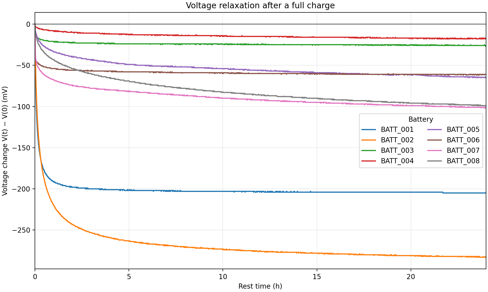
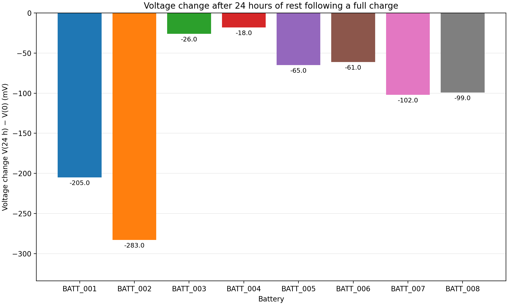

# Battery voltage relaxation analysis

## Aim

We looked at how the voltage of eight batteries changes during 24 hours of rest after a full charge.

The data come from [Borealis](https://demo.borealisdata.ca/dataset.xhtml?persistentId=doi:10.80240/FK2/WRCLHO&version=2.0). We only used measurements taken after charging to 100% to compare the batteries under this same condition. There are 11,528 measurements in total, with 1,441 measurements per battery.

## Method

The `preprocess.py` script combines the files and checks the time values, voltage values, missing values and duplicates. The raw data are kept unchanged, and no smoothing is applied.

The `analyze.py` script then calculates three voltage changes:

- from 0 to 1 hour;
- from 0 to 24 hours;
- from 22 to 24 hours.

Each change is the voltage at the end of the interval minus the voltage at the start. Values are given in millivolts (mV). A negative value means that the voltage decreased.

## Results

| Battery | Change 0–1 h (mV) | Change 0–24 h (mV) | Change 22–24 h (mV) |
|---|---:|---:|---:|
| BATT_001 | -192.000 | -205.000 | 0.000 |
| BATT_002 | -220.000 | -283.000 | -1.000 |
| BATT_003 | -21.000 | -26.000 | -0.300 |
| BATT_004 | -8.915 | -18.000 | 0.000 |
| BATT_005 | -33.928 | -65.000 | -1.000 |
| BATT_006 | -54.000 | -61.000 | 0.000 |
| BATT_007 | -68.000 | -102.000 | -2.000 |
| BATT_008 | -43.066 | -99.000 | -1.257 |

Table values are rounded to three decimal places. Detailed results are saved in `results/ocv_indicators.csv`.

The first figure shows the voltage change from the start of the rest period. The voltage drops quickly at first, then generally changes more slowly. The initial drop is especially large for BATT_001 and BATT_002.

The second figure compares the total voltage change after 24 hours. All batteries have a lower final voltage than at the start. BATT_002 has the largest drop, at 283 mV, while BATT_004 has the smallest, at 18 mV.

Changes between 22 and 24 hours are much smaller, ranging from -2 to 0 mV. This shows a smaller net change near the end of the recording, but it does not prove that the voltage is fully stable.

## Limits and conclusion

The batteries do not all behave in the same way during rest. However, we cannot explain these differences only by their chemistry, because their other characteristics may also differ.

This analysis describes the batteries in this dataset. It allows us to compare their curves, but we cannot apply the results to all batteries of the same type. The repeated measurements of one battery are not independent experimental repeats.
